# Avarma 12 kW × Home Assistant

Lokale Einbindung der Luft-Wasser-Wärmepumpe **Avarma 12 kW (Hofman HE-AI-290, R290)** in Home Assistant:
Modbus über RS485 mit einem **Waveshare ESP32-S3-RS485-CAN-U** und ESPHome, dazu ein fertiges Dashboard mit
Kältekreis-Schema, Kältekreis-Ampel, Energiebilanz, Diagnose und Parameter-Wirkung.

Ein Projekt von **AWendt206** – https://github.com/AWendt206/

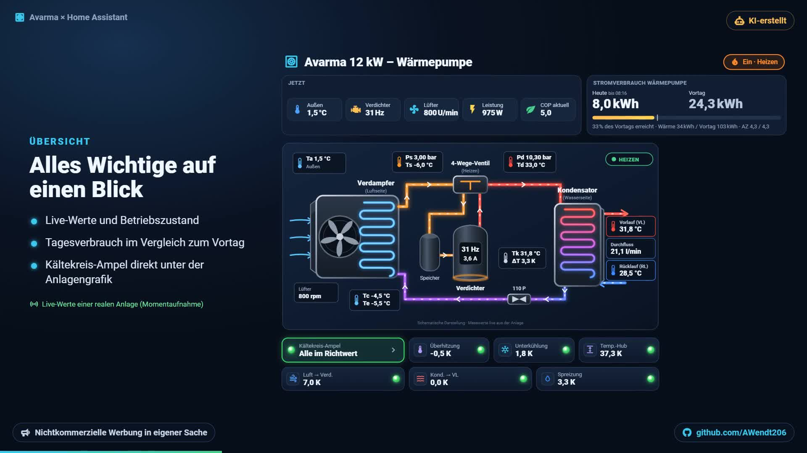

> [!WARNING]
> **Experimentell – keine Herstellerfreigabe.** Ampelfarben, Lernbänder, Diagnosen und Sterne sind eigene,
> statistische Auswertungen einer einzelnen Anlage. Eine statistische Häufigkeit ist kein technisch sicherer
> Normalbereich. Die Auswertung **ersetzt keine Schutzfunktion** der Wärmepumpe.
> Änderungen an Reglerparametern wirken sofort auf die Anlage. Arbeiten an Elektrik und Kältekreis (R290,
> brennbar) nur durch Fachkräfte. Nutzung auf eigene Gefahr – siehe [Sicherheit & Haftung](docs/sicherheit.md).

> [!TIP]
> **Neu bei Home Assistant oder ESPHome?** Die **[Schritt-für-Schritt-Anleitung für Einsteiger](docs/anleitung-einsteiger.md)**
> führt ohne Vorwissen vom Auspacken des ESP32 bis zum fertigen Dashboard – mit Checklisten und Fehlersuche.
>
> **Du nutzt einen KI-Assistenten mit Home-Assistant-MCP-Server?** Gib ihm das **[MCP_BRIEFING.md](MCP_BRIEFING.md)**
> und die Pflichtdateien – Anleitung: **[Installation mit KI-Assistent (MCP)](docs/anleitung-mcp.md)**.

## Inhalt

- [Screenshots](#screenshots)
- [Was du bekommst](#was-du-bekommst)
- [Welche Dateien brauche ich?](#welche-dateien-brauche-ich)
- [Hardware: Waveshare an der Displayleitung](#hardware-waveshare-an-der-displayleitung)
- [Registertabelle](#registertabelle)
- [Schnellstart](#schnellstart)
- [Kältekreis-Ampel und Handbuch](#kältekreis-ampel-und-handbuch)
- [Einstellungen gegen das Takten](#einstellungen-gegen-das-takten)
- [Kompatibilität](#kompatibilität)
- [Lizenz und Urheberrecht](#lizenz-und-urheberrecht)

## Screenshots

Echte Ansichten des Dashboards mit Messwerten einer laufenden Anlage (Momentaufnahmen, Heizbetrieb bei 1,5 °C außen;
Diagnose bei stehendem Verdichter).

### Übersicht

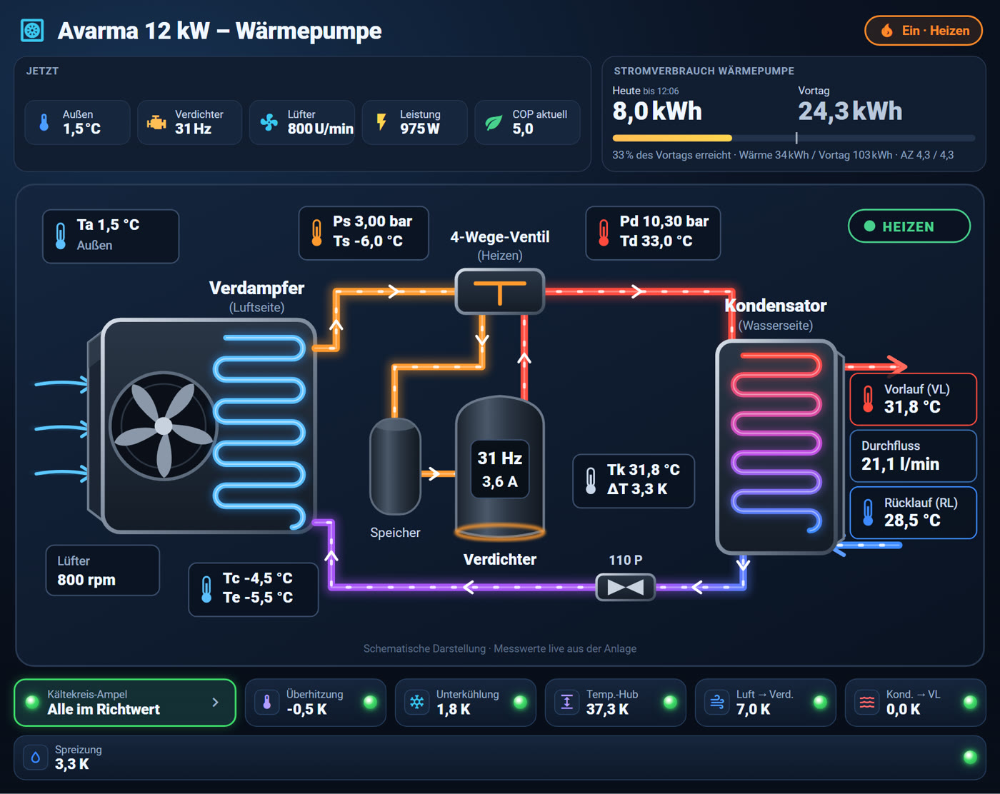

<table>
<tr>
<td width="62%"><b>Architektur</b><br>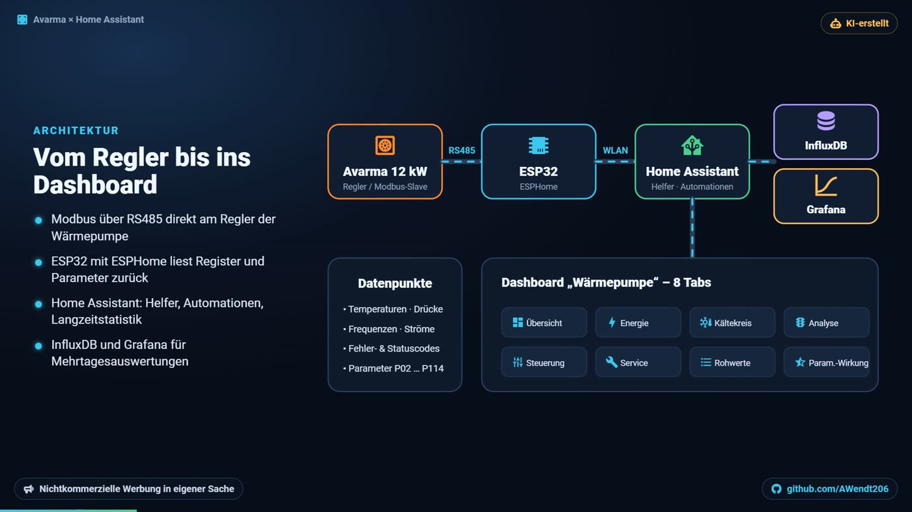</td>
<td width="38%"><b>Smartphone</b><br>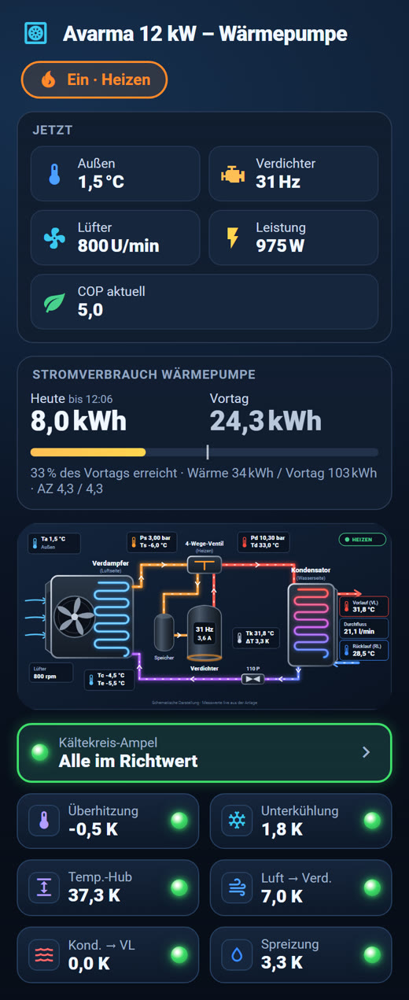</td>
</tr>
</table>

### Kältekreis

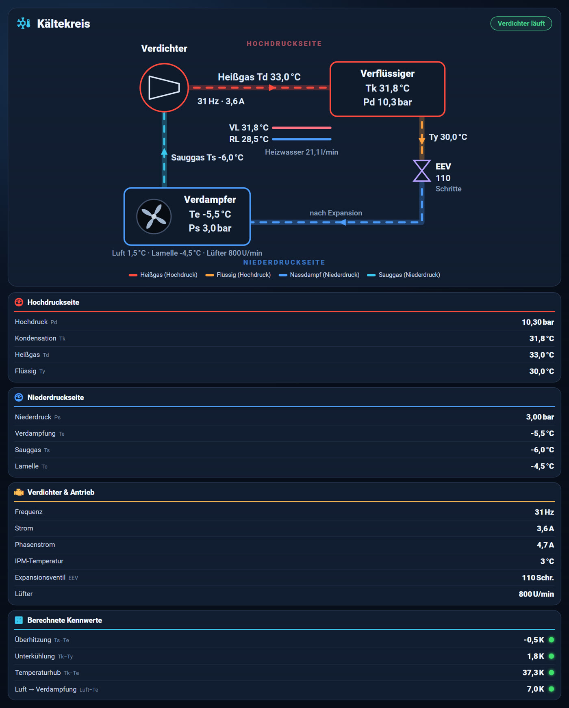

### Kältekreis-Ampel

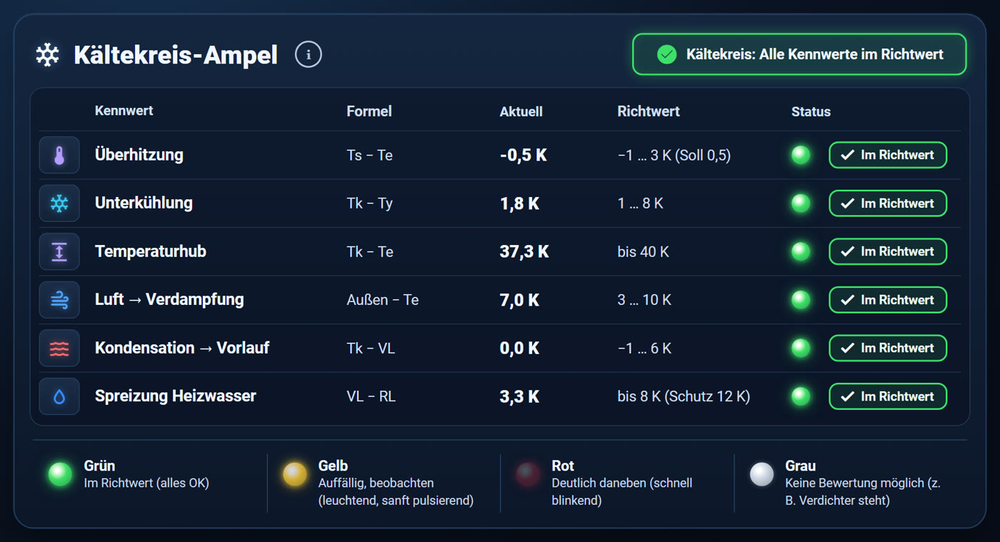

### Diagnose: Messqualität, Herstellersoll und Lernband

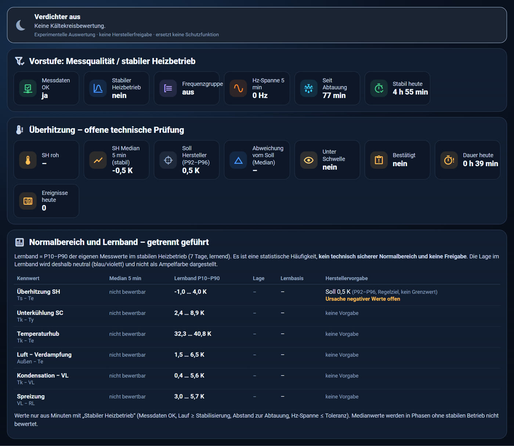

### Energiebilanz und CO₂

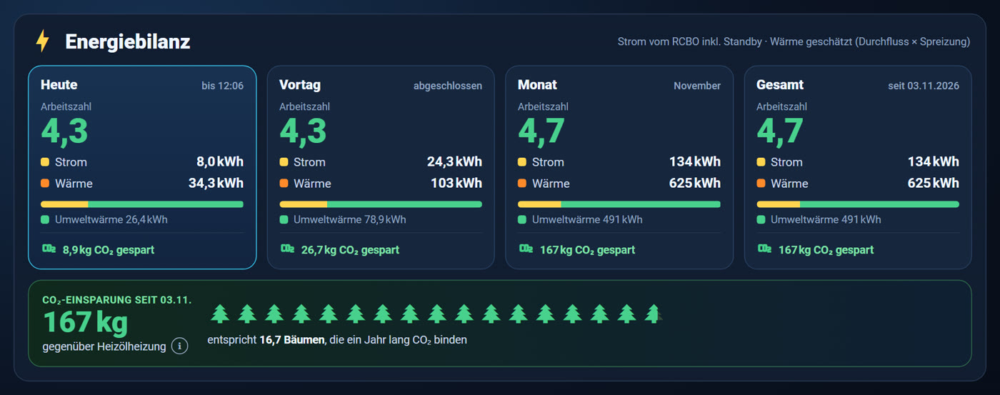

### Parameter-Wirkung

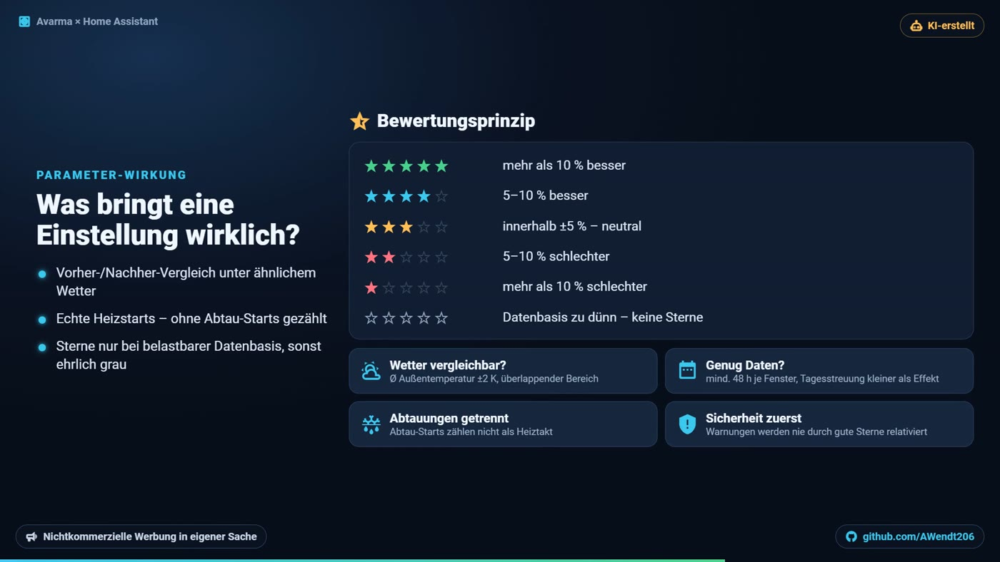

### Steuerung

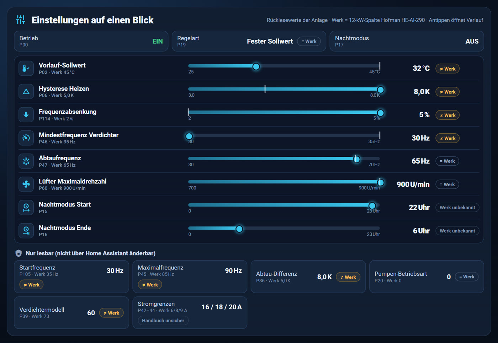

<details>
<summary><b>Tabelle „Optimierung gegen das Takten“ im Dashboard – Abgleich mit dem Handbuch</b></summary>

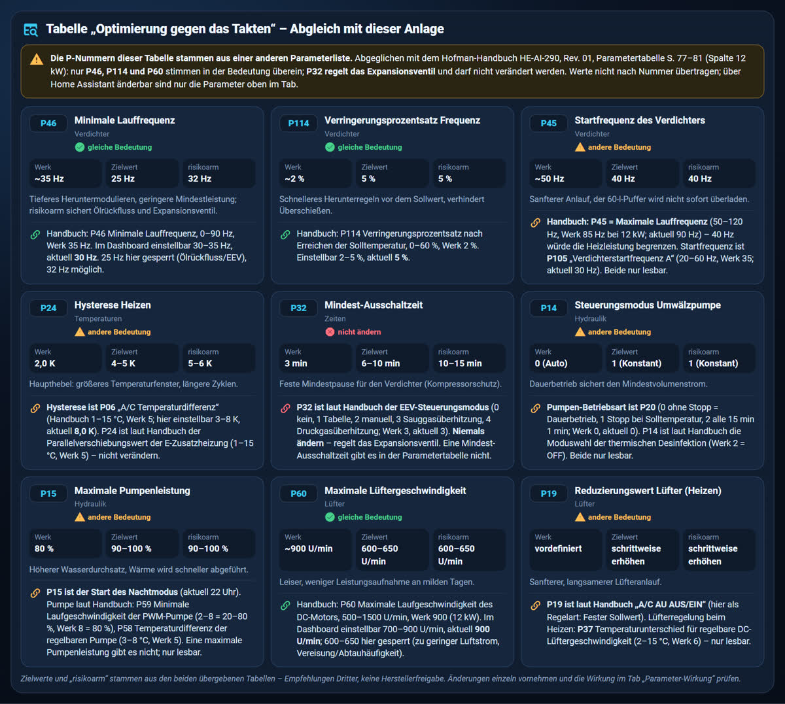

</details>

### Service und Systemzustand

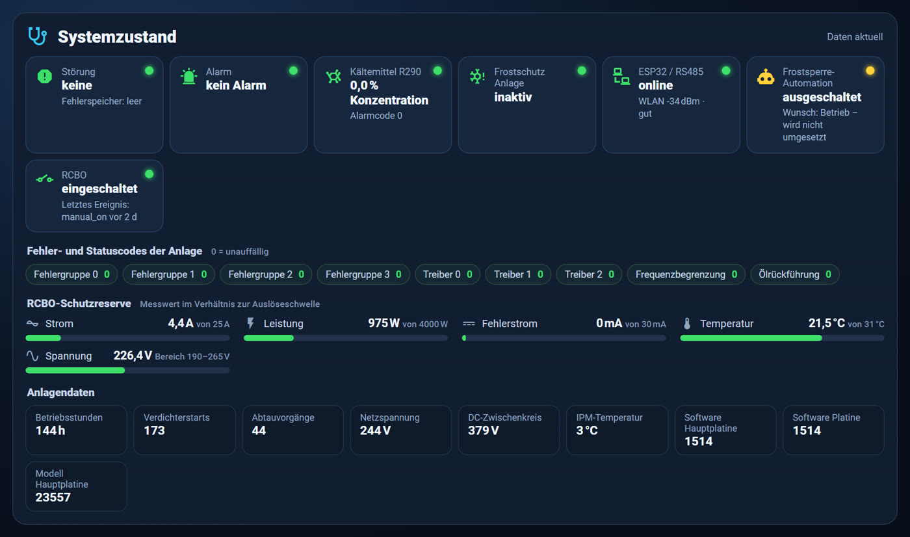

## Was du bekommst

| Baustein | Inhalt |
|---|---|
| **ESPHome** ([`esphome/`](esphome/)) | Modbus-RTU-Anbindung des Reglers: Messwerte, Zustandscodes, Fehlerspeicher, Parameter P01–P115 lesen; ausgewählte Einstellungen schreiben |
| **HA-Packages** ([`homeassistant/packages/`](homeassistant/packages/)) | über 100 Sensoren und Helfer als YAML: Status-Bits, Kältekreis-Kennwerte, Ampel, Energie & COP, Laufzeit/Starts, Diagnose mit Lernband |
| **Dashboard** ([`homeassistant/dashboard/`](homeassistant/dashboard/)) | 9 Ansichten: Übersicht, Energie, Kältekreis, Analyse, Diagnose, Steuerung, Service, Rohwerte, Parameter-Wirkung – smartphonetauglich |
| **Karte** ([`homeassistant/www/avarma/`](homeassistant/www/avarma/)) | `custom:avarma-parameter-wirkung` – Vorher/Nachher-Vergleich von Einstellungen, nur lesend |
| **Grafana** ([`grafana/`](grafana/)) | Import-Dashboard für InfluxDB 2: Kennwerte roh und als 5-min-Median, synchron mit Hz, Lüfter, Außen, Abtauung, VL/RL, Durchfluss, EEV |
| **Analyse** ([`analysis/`](analysis/)) | Python-Skripte für die Kalibrierung der Ampel aus der Recorder-Historie |

## Welche Dateien brauche ich?

| Datei | Status | Wofür | braucht |
|---|---|---|---|
| `esphome/avarma.yaml` | **Pflicht** | ESP32-Firmware (Modbus zur Avarma) | eigene `secrets.yaml` |
| `homeassistant/packages/avarma_basis.yaml` | **Pflicht** | Status-Bits, Fehler, Kältekreis-Kennwerte | ESPHome-Gerät |
| `homeassistant/packages/avarma_ampel.yaml` | **Pflicht** | Kältekreis-Ampel | basis |
| `homeassistant/packages/avarma_betrieb.yaml` | **Pflicht** | Laufzeit, Starts, Parameterspiegel, Vergleichsfenster | basis |
| `homeassistant/packages/avarma_energie.yaml` | **Pflicht** | Wärme, Strom, COP – Strommessung eintragen | basis |
| `homeassistant/packages/avarma_diagnose.yaml` | **Pflicht** | Messqualität, Diagnose, Lernband | basis, betrieb |
| `homeassistant/dashboard/avarma_dashboard.yaml` | **Pflicht** | Dashboard mit 9 Ansichten | alle Packages + button-card, card-mod, apexcharts-card |
| `homeassistant/www/avarma/avarma-parameter-wirkung-card.js` | **Pflicht** für Tab „Parameter-Wirkung“ | eigene Karte | betrieb |
| `homeassistant/packages/optional/avarma_frostsperre.yaml` | optional | schaltet die Anlage EIN/AUS (startet deaktiviert) | basis |
| `grafana/`, `analysis/` | optional | Langzeitauswertung, Kalibrierung | InfluxDB bzw. Python |
| `MCP_BRIEFING.md` | für KI-Assistenten | Auftrag und Regeln für die Installation per MCP | – |
| `README.md`, `docs/`, `LICENSE`, `NOTICE.md` | Dokumentation | `LICENSE` und `NOTICE.md` bei Weitergabe beilegen | – |

Abhängigkeiten: `basis` ist die Grundlage; `ampel`, `betrieb` und `energie` bauen darauf auf, `diagnose` braucht
zusätzlich `betrieb`. Die Packages also immer **alle fünf zusammen** installieren.

## Hardware: Waveshare an der Displayleitung

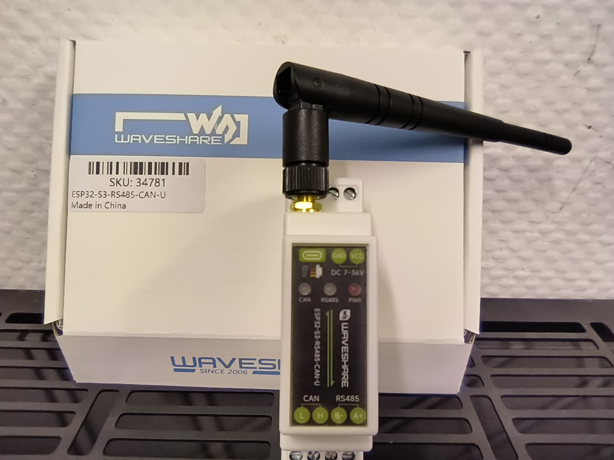

Der **Waveshare ESP32-S3-RS485-CAN-U** (Hutschiene, 7–36 V DC, RS485, WLAN mit externer Antenne) wird an die
**Displayleitung des Avarma-Bediendisplays** angeschlossen. Die Adern dieser Leitung sind beschriftet:

| Ader | Verwendung |
|---|---|
| **A+** | an `A+` des Waveshare |
| **B−** | an `B−` des Waveshare |
| **12 V** | **weglassen** – nicht anschließen, Ader isolieren |

- Das **Display wird nicht mehr genutzt.** Es arbeitet auf dieser Leitung selbst als Modbus-Master. Zwei Master auf
  einer Leitung stören sich, deshalb übernimmt der ESP32 seine Rolle. Bedienung und Anzeige laufen danach über Home Assistant.
- Der ESP32 wird **eigenständig versorgt** (Hutschienennetzteil oder USB-C), nicht über die 12-V-Ader.
  Eigenständige ESP32-Aufbauten für die Avarma stelle ich in meinen weiteren GitHub-Projekten vor:
  https://github.com/AWendt206/
- Schnittstelle: 9600 Baud, 8N1, Modbus-Slave-Adresse 1 (Handbuch P108 = 1), Abfrage alle 10 s;
  Waveshare-intern TX = GPIO17, RX = GPIO18, Richtung = GPIO21.
- dieser waveshare ist galvanisch getrennt, es wird ein externes 12V Netzteil empfohlen
Details, Stückliste und Sicherheitshinweise: [docs/hardware.md](docs/hardware.md)

## Registertabelle

Die Modbus-Registeradressen in [`esphome/avarma.yaml`](esphome/avarma.yaml) wurden mit der Veröffentlichung von
**KaHu85** ([HA-Hofman-Energy-Dashboard-avarma-heatpump](https://github.com/KaHu85/HA-Hofman-Energy-Dashboard-avarma-heatpump),
Lizenz **CC BY-NC-SA 4.0**) abgeglichen und an einer Avarma 12 kW V1 (Software Hauptplatine 1514) im Betrieb geprüft.
Deshalb steht diese eine Datei ebenfalls unter **CC BY-NC-SA 4.0** (Namensnennung, nicht kommerziell, Weitergabe unter
gleichen Bedingungen). Der Rest des Projekts steht unter MIT. Die Zuordnung ist **nicht vom Hersteller bestätigt**.

## Schnellstart

1. **ESPHome**: [`esphome/avarma.yaml`](esphome/avarma.yaml) übernehmen, `secrets.yaml` nach
   [`secrets.example.yaml`](esphome/secrets.example.yaml) anlegen, flashen. Gerätename `Hausinstallation Avarma`
   beibehalten (sonst Entitäts-IDs anpassen).
2. **Packages**: In `configuration.yaml` aktivieren
   ```yaml
   homeassistant:
     packages: !include_dir_named packages
   ```
   und die Dateien aus [`homeassistant/packages/`](homeassistant/packages/) nach `/config/packages/` kopieren.
   In `avarma_energie.yaml` deine Strommessung eintragen.
3. **Frontend**: benötigte Fremdkarten `button-card`, `card-mod`, `apexcharts-card` über HACS bzw. den Marketplace
   installieren (nicht Bestandteil dieses Projekts); `avarma-parameter-wirkung-card.js` nach `/config/www/avarma/`
   kopieren und als Ressource registrieren.
4. **Dashboard**: neues Dashboard anlegen → Rohdaten-Konfigurationseditor → Inhalt von
   [`avarma_dashboard.yaml`](homeassistant/dashboard/avarma_dashboard.yaml) einfügen.

Ausführlich: [docs/installation.md](docs/installation.md) · Ohne Vorwissen: [Anleitung für Einsteiger](docs/anleitung-einsteiger.md) · Mit KI-Assistent: [MCP-Anleitung](docs/anleitung-mcp.md) + [MCP_BRIEFING.md](MCP_BRIEFING.md)

## Kältekreis-Ampel und Handbuch

Grundlage für alle Herstellerbezüge: **Hofman Betriebsanleitung HE-AI-290, Rev. 01 (11.10.2022),
Parametertabelle S. 77–81**, Spalte 12 kW. Die Ampel liest nur – sie ändert keine Parameter.

### Wann bewertet wird

Grün, Gelb und Rot gibt es nur, wenn der Kältekreis **bewertbar** ist:

- ESP32 verbunden
- Verdichter läuft seit mindestens 10 min
- letzte Abtauung mindestens 10 min her
- alle sieben Temperaturfühler liefern Werte

Sonst ist die Ampel **grau** („inaktiv“ oder „unbekannt“). Zwischen den Stufen liegt eine Hysterese von 0,3 K,
damit die Farbe nicht flackert. Die Diagnose-Ansicht verlangt zusätzlich einen **stabilen Heizbetrieb**:

- Frequenz innerhalb ±5 Hz über 5 min
- Messdaten nicht älter als 30 min
- Abtau-Bits 16 und 1024 aus
- 4-Wege-Ventil seit der Stabilisierungszeit unverändert

Alle diese Grenzen sind in der Ansicht **Diagnose** einstellbar.

### Kennwerte, Richtwerte und Bezug zum Handbuch

| Kennwert | Formel | Grün | Gelb | Rot | Bezug zum Handbuch |
|---|---|---|---|---|---|
| **Überhitzung** | Ts − Te | −1 … 3 K | außerhalb | **nie** | **P92/P93/P94/P96** Soll-Ansaugüberhitzung Heizen **0,5 K** (je nach Außentemperatur; Kühlen **P95** = 3 K). **P32** = 3: EEV regelt auf Sauggasüberhitzung, **P89** = 0,3, **P90** = 1. Das Soll ist ein **Regelziel, kein Grenzwert** – daher kein Rot. |
| **Unterkühlung** | Tk − Ty | 1 … 8 K | < 1 oder > 8 K | < 0 oder > 12 K | keine Herstellerangabe – eigener Erfahrungswert |
| **Temperaturhub** | Tk − Te | bis 40 K | > 40 K | > 50 K | keine direkte Angabe; die Schutzfunktionen des Reglers greifen über den Hochdruck (**P51** Frequenzbegrenzung ab 2,95 MPa, **P53** Hochdruckschutz 3,2 MPa) |
| **Luft → Verdampfung** | Außen − Te | 3 … 10 K | < 3 oder > 10 K | < 1 oder > 14 K | indirekt: Abtaueinleitung über die Verdampfertemperatur (**P29** −3 °C) und die Differenz Umgebung/Verdampfer bei unter −7 °C Außentemperatur (**P91** ΔT2 = 8 °C); Lüfterregelung **P37** (6 °C) |
| **Kondensation → Vorlauf** | Tk − VL | −1 … 6 K | außerhalb | < −3 oder > 10 K | keine Herstellerangabe – eigener Erfahrungswert |
| **Spreizung** | VL − RL | bis 8 K | > 8 oder < −0,5 K | ≥ 12 K | **P58** Temperaturdifferenz der regelbaren Pumpe **5 °C** (3–8); **P102** Schutz-Temperaturdifferenz Vor-/Rücklauf **12 °C** – Rot ab 12 K entspricht dieser Herstellergrenze; Fehler **E22** „Spreizung VL/RL zu groß“ |

**Rot** gibt es außerdem immer bei einem **Herstelleralarm oder Fehlercode** des Reglers. Dieser Status hat Vorrang vor
jeder eigenen Bewertung.

### Überhitzung: warum kein Rot

- Laut Handbuch regelt das EEV beim Heizen auf **0,5 K** Sauggasüberhitzung.
- An der Messanlage lag der Mittelwert im stabilen Heizbetrieb bei **+0,38 K**, nahe am Soll.
- Te wird in 0,5-K-Schritten gemeldet, Ts und Te werden nicht gleichzeitig aktualisiert. Werte zwischen etwa −1 und +1 K
  sind deshalb messtechnisch nicht von 0 zu unterscheiden. Rechnerisch negative Werte sind bei diesem Soll normal.
- Eine Alarmgrenze für die Überhitzung nennt der Hersteller nicht. Das Projekt erfindet keine.
- Die Ansicht **Diagnose** zeigt Sollwert und Abweichung getrennt. **Gelb** („Prüfen: Messkette“) erscheint erst, wenn der
  5-min-Median im stabilen Betrieb länger als die Bestätigungsdauer (Standard 15 min) unter der Diagnoseschwelle bleibt.
  Das ist ein Hinweis, keine Störungsmeldung.

Messdaten, Lernbänder und Herleitung: [docs/kalibrierung.md](docs/kalibrierung.md)

### Lernband statt fester Grenzen

Zusätzlich lernt die Diagnose je Kennwert ein **Lernband**: P10–P90 der eigenen Werte im stabilen Heizbetrieb über
7 Tage. Es zeigt, was an *dieser* Anlage üblich ist. Es ist kein technisch sicherer Normalbereich und keine Freigabe.
Deshalb wird es neutral dargestellt (blau/violett), nicht als Ampelfarbe.

## Einstellungen gegen das Takten

Die folgenden beiden Tabellen sind im Umlauf und werden oft zitiert. Ihre **Parameternummern passen nicht zur
Avarma/Hofman HE-AI-290.** Ich habe jede Zeile mit der Parametertabelle des Handbuchs (Rev. 01, S. 77–81, Spalte 12 kW)
abgeglichen. **Nie nach Nummer übertragen**, sondern nur nach der Spalte „Handbuch“.

> [!CAUTION]
> **P32 ist bei der Avarma der EEV-Steuerungsmodus** (Werk 3 = Sauggasüberhitzung) und keine Ausschaltzeit.
> Ein Wert von 6–15 verstellt die Regelung des Expansionsventils. **Nicht ändern.**

### Gesamttabelle: Optimierung gegen das Takten (Verdichter & Lüfter)

| Bereich | Param. (Tabelle) | Name laut Tabelle | Werk (Tabelle) | Zielwert | Auswirkung laut Tabelle | Handbuch HE-AI-290 (12 kW) |
|---|---|---|---|---|---|---|
| Verdichter / Modulation | P46 | Minimale Lauffrequenz | ~35 Hz | 25 Hz | Erlaubt tieferes Heruntermodulieren; reduziert die Mindestleistung in der Übergangszeit drastisch. | ✅ **P46** Minimale Lauffrequenz, 0–90 Hz, Werk 35. Dashboard erlaubt 30–35 Hz; 25 Hz bewusst gesperrt (Ölrückfluss, EEV). |
| | P114 | Verringerungsprozentsatz Frequenz | ~2 % | 5 % | Beschleunigt das Herunterregeln der Frequenz bei Annäherung an die Zieltemperatur (verhindert Überschießen). | ✅ **P114** nach Erreichen der Solltemperatur, 0–60 %, Werk 2. |
| | P45 | Startfrequenz des Verdichters | ~50 Hz | 40 Hz | Sanfterer Anlauf; der kleine 60-l-Puffer wird beim Start nicht sofort mit Energie überladen. | ⚠️ **P45 = Maximale Lauffrequenz** (50–120 Hz, Werk 85) – 40 Hz würde die Heizleistung begrenzen! Startfrequenz ist **P105** „Verdichterstartfrequenz A“ (20–60 Hz, Werk 35). |
| Temperaturen & Zeiten | P24 | Hysterese Heizen | 2,0 K | 4,0–5,0 K | Vergrößert das Temperaturfenster. Das Heizwasser muss tiefer abkühlen, bevor die WP neu startet. | ⚠️ Hysterese ist **P06** „A/C Temperaturdifferenz“ (1–15 °C, Werk 5). P24 = Parallelverschiebung E-Zusatzheizung – nicht ändern. |
| | P32 | Mindest-Ausschaltzeit | 3 min | 6–10 min | Erzwingt eine längere zeitliche Pause für den Kompressor nach dem Abschalten (Kompressorschutz). | ⛔ **P32 = EEV-Steuerungsmodus** (Werk 3). Eine Mindest-Ausschaltzeit gibt es in der Parametertabelle nicht. **Nicht ändern.** |
| Hydraulik / Durchfluss | P14 | Steuerungsmodus Umwälzpumpe | 0 (Auto) | 1 (Konstant) | Schaltet die interne Pumpe auf Dauerbetrieb, um den kritischen Mindestvolumenstrom zu sichern. | ⚠️ Pumpenbetrieb ist **P20** (0 = ohne Stopp = Dauerbetrieb, **Werk 0**). P14 = Moduswahl thermische Desinfektion (Werk 2 = OFF). |
| | P15 | Maximale Pumpenleistung | 80 % | 90–100 % | Erhöht den Wasserdurchsatz. Transportiert die Wärme schneller weg von der WP in die Heizkörper. | ⚠️ P15 = **Nachtmodus Start** (Uhrzeit). Pumpe: **P59** minimale PWM-Drehzahl (2–8 = 20–80 %, Werk 8 = 80 %), **P58** Pumpen-Temperaturdifferenz (Werk 5 °C). Eine „maximale Pumpenleistung“ gibt es nicht. |
| Lüfter / Akustik | P60 | Maximale Lüftergeschwindigkeit | ~900 rpm | 600–650 rpm | Macht das Außengerät flüsterleise und bremst die Energieaufnahme an milden Tagen leicht ein. | ✅ **P60** max. Drehzahl DC-Lüfter, 500–1500 U/min, Werk 900. Dashboard erlaubt 700–900 U/min (zu wenig Luft fördert Vereisung und Abtauungen). |
| | P19 | Reduzierungswert Lüfter (Heizen) | vordefiniert | schrittweise erhöhen | Erzwingt einen sanfteren, langsameren Anlauf des Ventilators. | ⚠️ P19 = „A/C AU AUS/EIN“. Lüfterregelung beim Heizen: **P37** Temperaturunterschied für regelbare DC-Lüftergeschwindigkeit (2–15 °C, Werk 6). |

### Risikooptimierte Gesamttabelle: Einstellungen gegen das Takten

| Bereich | Param. (Tabelle) | Name laut Tabelle | Werk (Tabelle) | Zielwert (risikoarm) | Auswirkung & Nutzen laut Tabelle | Handbuch HE-AI-290 (12 kW) |
|---|---|---|---|---|---|---|
| Verdichter & Schutz | P46 | Minimale Lauffrequenz | ~35 Hz | 32 Hz | Sicherer Kompromiss: reduziert die Mindestleistung leicht, sichert aber Ölrückfluss und die korrekte Funktion des Expansionsventils. | ✅ **P46**, Werk 35, im Dashboard einstellbar (30–35 Hz). |
| | P114 | Verringerungsprozentsatz Frequenz | ~2 % | 5 % | Beschleunigt das Herunterregeln der Frequenz bei Annäherung an die Zieltemperatur (verhindert Überschießen). | ✅ **P114**, Werk 2, im Dashboard einstellbar (2–5 %). |
| | P45 | Startfrequenz des Verdichters | ~50 Hz | 40 Hz | Sanfterer Anlauf; der kleine 60-l-Puffer wird beim Start nicht sofort mit Energie überladen. | ⚠️ siehe oben: **P45 = Maximalfrequenz**, Startfrequenz = **P105** (Werk 35) – nur lesbar. |
| Temperaturen & Zeiten | P24 | Hysterese Heizen | 2,0 K | 5,0–6,0 K | Haupthebel: vergrößert das Temperaturfenster; das Heizwasser muss tiefer abkühlen, bevor die WP neu startet (streckt die Zyklen). | ⚠️ Hysterese = **P06** (Werk 5), im Dashboard einstellbar 3–8 K. |
| | P32 | Mindest-Ausschaltzeit | 3 min | 10–15 min | Mechanische Bremse: erzwingt eine feste Mindestpause für den Kompressor nach dem Abschalten (Kompressorschutz). | ⛔ **P32 = EEV-Steuerungsmodus. Nicht ändern.** |
| Hydraulik / Durchfluss | P14 | Steuerungsmodus Umwälzpumpe | 0 (Auto) | 1 (Konstant) | Schaltet die interne Pumpe auf Dauerbetrieb, um den kritischen Mindestvolumenstrom zu sichern. | ⚠️ Pumpenbetrieb = **P20**, Werk 0 = bereits Dauerbetrieb. |
| | P15 | Maximale Pumpenleistung | 80 % | 90–100 % | Erhöht den Wasserdurchsatz; transportiert die Wärme schneller in die Heizkörper. | ⚠️ P15 = Nachtmodus Start. Pumpe: **P59** (Werk 80 % = Maximum des Bereichs). |
| Lüfter / Akustik | P60 | Maximale Lüftergeschwindigkeit | ~900 rpm | 600–650 rpm | Macht das Außengerät flüsterleise und bremst die Energieaufnahme an milden Tagen leicht ein. | ✅ **P60**, Werk 900; im Dashboard 700–900 U/min. |
| | P19 | Reduzierungswert Lüfter (Heizen) | vordefiniert | schrittweise erhöhen | Erzwingt einen sanfteren, langsameren Anlauf des Ventilators. | ⚠️ Lüfterregelung = **P37** (Werk 6 °C), nur lesbar. |

**Was davon im Dashboard (Tab „Steuerung“) einstellbar ist:** P06 Hysterese, P46 Mindestfrequenz, P47 Abtaufrequenz,
P114 Frequenzabsenkung, P60 Lüfter max, P02 Vorlauf-Soll, P15–P17 Nachtmodus, Betrieb EIN/AUS und die Regelart.
Alle anderen Parameter werden nur gelesen. Immer **nur einen Wert ändern**, den alten notieren und die Wirkung im Tab
**Parameter-Wirkung** (Vorher/Nachher-Vergleich) prüfen. Zielwerte aus Tabellen Dritter sind keine Herstellerfreigabe.

## Kompatibilität

Getestet mit Avarma 12 kW V1 (Software Hauptplatine 1514), Home Assistant 2026.11 und aktuellem ESPHome.
Andere Leistungsgrößen (6/9/16 kW) haben laut Handbuch teils andere Werkseinstellungen (z. B. P45, P60). Ob die
Registertabelle dort identisch ist, ist **nicht geprüft**. Rückmeldungen gern als [Issue](../../issues).

## Lizenz und Urheberrecht

Copyright (c) 2026 **AWendt206** – https://github.com/AWendt206/

- [MIT-Lizenz](LICENSE) für das gesamte Projekt, **ausgenommen** [`esphome/avarma.yaml`](esphome/avarma.yaml):
  Sie steht unter **CC BY-NC-SA 4.0**, weil die Registeradressen mit der Veröffentlichung von KaHu85 (CC BY-NC-SA 4.0)
  abgeglichen wurden. Einzelheiten: [NOTICE.md](NOTICE.md)
- Bei Weitergabe oder Bearbeitung bitte den Urheberhinweis „AWendt206 – https://github.com/AWendt206/“ erhalten
  (für die ESPHome-Datei zusätzlich KaHu85).
- Benötigte Fremdkarten (button-card, card-mod, apexcharts-card) sind nicht enthalten und unterliegen ihren eigenen Lizenzen.
- Kein offizielles Projekt von Avarma bzw. Hofman und nicht mit diesen verbunden. Markennamen nur zur Beschreibung der
  Kompatibilität. Erstellt mit Unterstützung von KI (Claude, Anthropic) und vom Autor geprüft.
  Nichtkommerzielles Projekt. Änderungen und Irrtümer vorbehalten.
