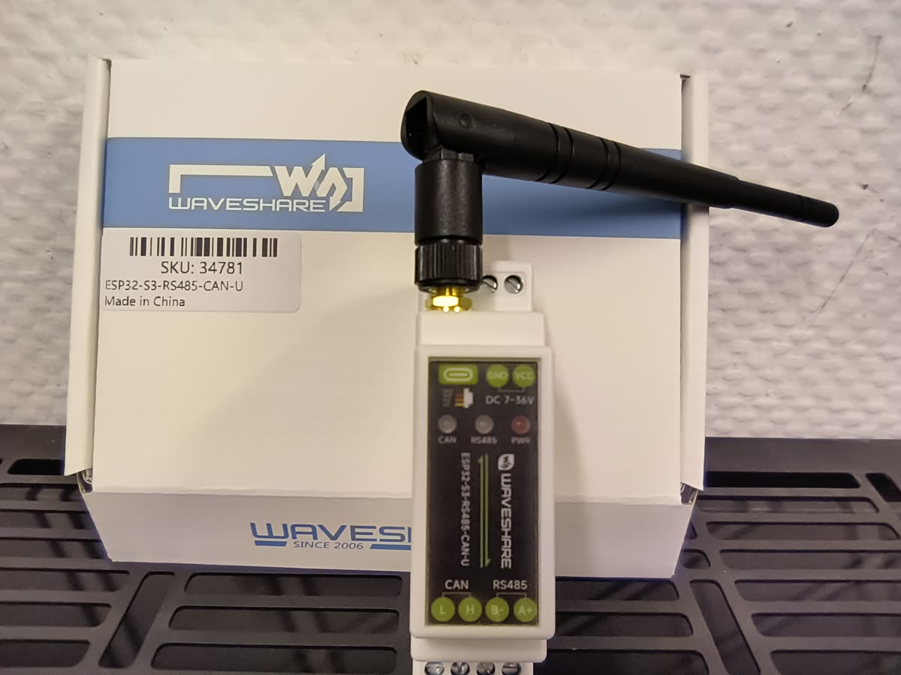
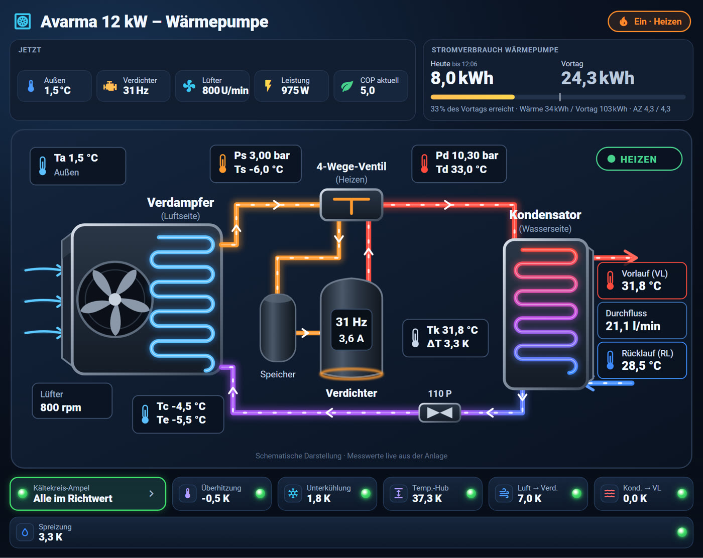

# Schritt-für-Schritt-Anleitung für Einsteiger

> Du hast einen KI-Assistenten mit Home-Assistant-MCP-Server? Nach Schritt 4 kann er die Schritte 5–7 übernehmen:
> [Installation mit KI-Assistent (MCP)](anleitung-mcp.md)

Copyright (c) 2026 AWendt206 – https://github.com/AWendt206/

Diese Anleitung setzt **kein Vorwissen** voraus. Sie führt dich vom Auspacken des ESP32 bis zum fertigen Dashboard.
Plane etwa **2–3 Stunden** ein. Arbeite die Schritte der Reihe nach ab und hake sie ab.

> [!WARNING]
> Die Wärmepumpe ist ein elektrisches Gerät mit brennbarem Kältemittel (R290). **Das Gehäuse öffnet nur eine
> Elektrofachkraft, und nur spannungsfrei.** Alles andere in dieser Anleitung passiert am Computer.

---

## Was du brauchst

**Einkaufsliste**

- [ ] Waveshare **ESP32-S3-RS485-CAN-U** (inklusive Antenne)
- [ ] USB-C-Kabel (Daten, nicht nur Laden) für das erste Aufspielen
- [ ] Netzteil 12 V oder 24 V DC für den ESP32 (z. B. Hutschienennetzteil)
- [ ] 2-adrige Leitung, falls die Displayleitung nicht bis zum ESP32 reicht
- [ ] optional: Strommessung für die Wärmepumpe (z. B. Zwischenzähler oder Leitungsschutzschalter mit Messung)

**Software**

- [ ] **Home Assistant** läuft bereits (Home Assistant OS, Version 2026.11 oder neuer empfohlen)
- [ ] ein Computer mit **Chrome oder Edge** (für das erste Aufspielen per USB)
- [ ] die Projektdatei **`avarma-ha-v0.1.0.zip`** – herunterladen und entpacken

**Begriffe, die gleich vorkommen**

| Begriff | Bedeutung |
|---|---|
| **ESPHome** | Programm, das die Software für den ESP32 erzeugt. Läuft als App in Home Assistant. |
| **YAML** | Textformat der Konfigurationsdateien. **Einrückungen (Leerzeichen) sind wichtig** – nie Tabulatoren verwenden. |
| **Entität** | ein einzelner Wert in Home Assistant, z. B. `sensor.hausinstallation_avarma_aussentemperatur` |
| **Package** | eine YAML-Datei, die viele Entitäten auf einmal anlegt |
| **Modbus / RS485** | die Datenleitung, über die der ESP32 mit dem Regler der Wärmepumpe spricht |

---

## Schritt 1 – Home Assistant vorbereiten (15 min)

1. **ESPHome installieren:** *Einstellungen → Apps* (früher „Add-ons“) → *App-Store* → **ESPHome Device Builder** →
   *Installieren* → *Starten* → „In Seitenleiste anzeigen“ einschalten.
2. **Dateieditor installieren:** im selben App-Store **File editor** (oder *Studio Code Server*) installieren,
   starten und in der Seitenleiste anzeigen. Damit bearbeitest du später Dateien in `/config`.
3. **Erweiterter Modus:** unten links auf deinen Namen klicken → **Erweiterter Modus** einschalten.

✅ *Geschafft, wenn* in der Seitenleiste „ESPHome Builder“ und „File editor“ erscheinen.

---

## Schritt 2 – ESP32 zum ersten Mal bespielen (20 min)

1. Den ESP32 per **USB-C** an den Computer anschließen (noch **nicht** an die Wärmepumpe).
2. *ESPHome Builder* öffnen → **Secrets** (oben rechts) → folgenden Inhalt einfügen und **deine Werte** eintragen:
   ```yaml
   wifi_ssid: "Name deines WLANs"
   wifi_password: "Dein WLAN-Passwort"
   ap_password: "beliebiges Passwort für den Notfall-Hotspot"
   api_encryption_key: "HIER_SCHLÜSSEL"
   ota_password: "beliebiges Passwort für Updates"
   ```
   Den `api_encryption_key` bekommst du erst im nächsten Schritt – die Zeile vorerst so stehen lassen.
3. **+ Neues Gerät** → Name `hausinstallation-avarma` → *Überspringen* bzw. *Weiter* → Gerätetyp **ESP32-S3**.
   Am Ende zeigt ESPHome einen **Verschlüsselungsschlüssel** an: kopieren, in den *Secrets* bei
   `api_encryption_key` statt `HIER_SCHLÜSSEL` einfügen und speichern. Den Schlüssel notieren, du brauchst ihn in Schritt 4.
4. Beim neuen Gerät auf **Bearbeiten** klicken, **alles löschen** und den kompletten Inhalt von
   `esphome/avarma.yaml` aus dem ZIP einfügen → **Speichern**.
5. **Installieren** → **Mit diesem Computer verbinden** → den COM-Port des ESP32 auswählen.
   Das erste Kompilieren dauert 5–10 Minuten.
6. Nach „Installation erfolgreich“ den ESP32 abziehen.

✅ *Geschafft, wenn* das Gerät im ESPHome Builder als **Online** angezeigt wird, sobald es wieder Strom hat.

> **Wichtig:** Den Namen **„Hausinstallation Avarma“** nicht ändern. Sonst passen die Entitäten nicht zu den Packages.

---

## Schritt 3 – Anschluss an die Wärmepumpe (Elektrofachkraft, 30 min)



1. Wärmepumpe **spannungsfrei** schalten und gegen Wiedereinschalten sichern.
2. Die **Displayleitung** des Avarma-Bediendisplays vom Display abziehen. Die Adern sind beschriftet.
3. Nur **A+** an `A+` und **B−** an `B−` des Waveshare anschließen.
4. Die **12-V-Ader nicht anschließen**, sondern isolieren. Andere Adern ebenfalls nicht anschließen.
5. Den ESP32 über sein **eigenes Netzteil** an `VCC`/`GND` (7–36 V DC) versorgen.
6. Antenne anschrauben, Gehäuse schließen, Spannung wieder einschalten.

Das Display bleibt abgeklemmt und wird nicht mehr genutzt. Der ESP32 übernimmt seine Aufgabe; Bedienung und Anzeige
laufen über Home Assistant. Mehr dazu: [hardware.md](hardware.md)

✅ *Geschafft, wenn* die RS485-LED am Waveshare im Takt von etwa 10 Sekunden flackert.

---

## Schritt 4 – Gerät in Home Assistant übernehmen (5 min)

1. *Einstellungen → Geräte & Dienste*. Unter „Entdeckt“ erscheint **Hausinstallation Avarma** → *Konfigurieren* →
   bei Nachfrage den `api_encryption_key` aus Schritt 2 eingeben.
2. Das Gerät öffnen: Es sollten über 190 Entitäten mit Werten erscheinen (Außentemperatur, Vorlauf, Drücke …).

✅ *Geschafft, wenn* `sensor.hausinstallation_avarma_aussentemperatur` eine plausible Temperatur zeigt.
❌ *Alle Werte „Nicht verfügbar“?* → siehe [Fehlersuche](#fehlersuche).

---

## Schritt 5 – Packages einspielen (15 min)

1. *File editor* öffnen → oben links auf das Ordnersymbol → im Ordner `/config` einen neuen Ordner **`packages`** anlegen.
2. Die fünf Dateien aus `homeassistant/packages/` des ZIPs in `/config/packages/` hochladen
   (Ordnersymbol → *Upload file*):
   `avarma_basis.yaml`, `avarma_ampel.yaml`, `avarma_betrieb.yaml`, `avarma_energie.yaml`, `avarma_diagnose.yaml`.
   Die Datei aus `optional/` **nicht** hochladen. Sie schaltet die Anlage und ist nur für Fortgeschrittene.
3. `/config/configuration.yaml` öffnen und **ganz oben** (oder in einen vorhandenen `homeassistant:`-Abschnitt)
   einfügen:
   ```yaml
   homeassistant:
     packages: !include_dir_named packages
   ```
   Gibt es `homeassistant:` schon, nur die Zeile `packages: …` eingerückt darunter ergänzen. `homeassistant:` darf
   nicht doppelt vorkommen.
4. **Strommessung** (optional): `avarma_energie.yaml` öffnen und `sensor.DEIN_STROMZAEHLER_LEISTUNG` sowie
   `sensor.DEIN_STROMZAEHLER_ENERGIE` durch deine Entitäten ersetzen. Die Namen findest du unter
   *Entwicklerwerkzeuge → Zustände*. Ohne Strommessung einfach so lassen; dann bleiben COP und Verbrauch leer.
5. *Entwicklerwerkzeuge → YAML* → **Konfiguration prüfen**. Erst bei „Konfiguration in Ordnung“ weiter.
6. *Einstellungen → System → Neu starten*.

✅ *Geschafft, wenn* unter *Entwicklerwerkzeuge → Zustände* beim Filter `avarma_` z. B. `sensor.avarma_uberhitzung`
und `sensor.avarma_kk_diagnosestatus` erscheinen.

---

## Schritt 6 – Zusatzkarten installieren (10 min)

Das Dashboard braucht drei frei verfügbare Karten von anderen Autoren. Sie sind nicht Teil dieses Projekts.

1. *Einstellungen → Marketplace* (bei älteren Versionen: **HACS**) → nacheinander suchen und installieren:
   **button-card**, **card-mod**, **apexcharts-card**.
2. Die eigene Karte: im *File editor* den Ordner `/config/www/avarma/` anlegen und
   `homeassistant/www/avarma/avarma-parameter-wirkung-card.js` hineinladen.
3. *Einstellungen → Dashboards → ⋮ (oben rechts) → Ressourcen → Ressource hinzufügen*:
   URL `/local/avarma/avarma-parameter-wirkung-card.js?v=1.0.0`, Typ **JavaScript-Modul** → *Erstellen*.
4. Browser mit **Strg + Umschalt + R** neu laden.

---

## Schritt 7 – Dashboard einfügen (5 min)

1. *Einstellungen → Dashboards → + Dashboard hinzufügen → Neues Dashboard von Grund auf*.
   Titel „Wärmepumpe“, URL **`dashboard-waermepumpe-neu`** (dann passen alle internen Links).
2. Das neue Dashboard öffnen → ✏️ (Bearbeiten) → **⋮ → Rohdaten-Konfigurationseditor**.
3. Alles markieren (Strg + A), löschen und den kompletten Inhalt von
   `homeassistant/dashboard/avarma_dashboard.yaml` einfügen → **Speichern** → Editor schließen.

✅ *Geschafft, wenn* die Übersicht so aussieht:



---

## Schritt 8 – Kurz einrichten und loslegen

- **Raumtemperaturen** (Übersicht, optional): Die Karte erwartet `sensor.avarma_raum1_temperatur` usw.
  Am einfachsten benennst du deine Raumsensoren unter *Einstellungen → Entitäten* auf diese IDs um.
- **Grafana-Kacheln** im Tab Energie: Ohne Grafana zeigen sie nichts. Im Bearbeitungsmodus einfach löschen.
- **Diagnose-Grenzen**: Sie werden beim ersten Start automatisch gesetzt (10 min, 5 Hz, 0 K, 15 min).
  Ändern musst du nichts.
- **Lernband**: Es füllt sich in den ersten **7 Tagen** Heizbetrieb. Bis dahin steht dort „lernend“.

### Was die Tabs zeigen

| Tab | Wofür |
|---|---|
| **Übersicht** | Live-Werte, Kältekreis-Schema, Tagesverbrauch, Ampel |
| **Energie** | Strom, Wärme, Arbeitszahl, CO₂-Einsparung |
| **Kältekreis** | jeder Messwert an seinem Messpunkt |
| **Analyse** | Kältekreis-Ampel mit Richtwerten |
| **Diagnose** | Messqualität, stabiler Heizbetrieb, Überhitzung im Vergleich zum Herstellersoll, Lernband |
| **Steuerung** | die wenigen einstellbaren Parameter und die Tabelle „gegen das Takten“ |
| **Service** | Fehler, Alarme, R290-Sensor, Verbindung, Anlagenzähler |
| **Rohwerte** | alle gelesenen Rohwerte |
| **Parameter-Wirkung** | Vorher/Nachher-Vergleich einer Einstellung mit Sternen |

### Die drei goldenen Regeln

1. **Grau ist normal**, wenn der Verdichter steht oder gerade abtaut. Bewertet wird nur im stabilen Heizbetrieb.
2. **Immer nur einen Parameter ändern.** Den alten Wert notieren und die Wirkung nach einigen Tagen im Tab
   *Parameter-Wirkung* ansehen.
3. **Niemals P32 oder P89–P96 verändern.** Das ist die Regelung des Expansionsventils. Das Dashboard lässt es
   ohnehin nicht zu.

---

## Fehlersuche

| Problem | Ursache und Lösung |
|---|---|
| ESP32 im ESPHome Builder „Offline“ | WLAN-Daten in den Secrets prüfen; Antenne angeschraubt? Notfall-Hotspot „Avarma Fallback Hotspot“ erscheint, wenn das WLAN nicht klappt. |
| Gerät online, aber alle Avarma-Werte „Nicht verfügbar“ | A+ und B− vertauscht (einfach tauschen); Display noch angeschlossen (abklemmen, zwei Master stören sich); Leitung lose. |
| Entitäten heißen `sensor.avarma_…` statt `sensor.hausinstallation_avarma_…` | Der Gerätename wurde geändert. In der ESPHome-YAML `friendly_name: Hausinstallation Avarma` setzen und neu installieren, oder die Entitäten umbenennen. |
| „Konfiguration prüfen“ meldet einen Fehler | Meist falsche Einrückung oder `homeassistant:` doppelt. Die Fehlermeldung nennt Datei und Zeile. |
| Dashboard zeigt rote Kästen „Custom element doesn't exist“ | Zusatzkarte fehlt (Schritt 6) oder der Browser-Cache ist alt → Strg + Umschalt + R. |
| COP und Verbrauch zeigen „–“ | Keine Strommessung eingetragen (Schritt 5.4). |
| Ampel bleibt grau | Verdichter steht, Abtauung läuft oder der Verdichter läuft noch keine 10 min – das ist gewollt. |
| Lernband leer | normal in den ersten 7 Tagen |

Weitere Fragen gern als Issue im Projekt – **ohne Passwörter, Schlüssel oder IP-Adressen**.
