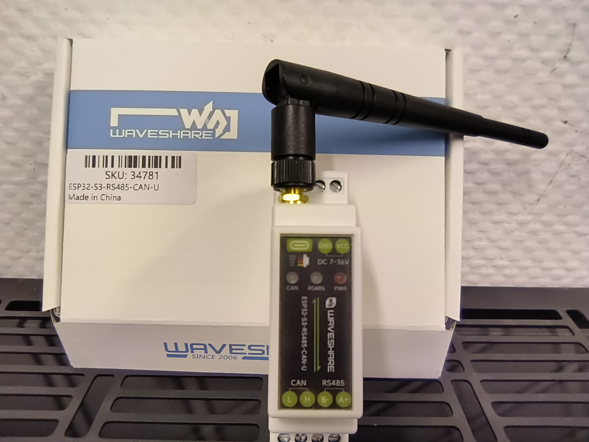

# Hardware

## Stückliste

| Teil | Hinweis |
|---|---|
| Waveshare **ESP32-S3-RS485-CAN-U** (SKU 34781) | ESP32-S3, RS485- und CAN-Schnittstelle, Hutschienengehäuse, Versorgung 7–36 V DC oder USB-C, SMA-Antenne |
| Netzteil 12 V oder 24 V DC (Hutschiene) | alternativ vorhandene Kleinspannung im Schaltschrank |
| 2-adrige, verdrillte Leitung (z. B. LiYCY 2×0,25 mm² oder J-Y(St)Y) | Schirm einseitig auflegen |
| optional: Strommessung der Wärmepumpe | beliebiger HA-Zähler (W und kWh) |

## Anschluss an die Displayleitung der Avarma

Der Waveshare-ESP32 wird **statt des Bediendisplays** an dessen Leitung angeschlossen (Anschluss COMM 4 /
Display-Port der Regelplatine). Die Adern der Displayleitung sind beschriftet.

| Ader der Displayleitung | Waveshare-Klemme | Hinweis |
|---|---|---|
| **A+** | `A+` (RS485) | verwenden |
| **B−** | `B−` (RS485) | verwenden |
| **12 V** | – | **nicht anschließen**, Ader isolieren |
| weitere Adern (z. B. GND) | – | nicht anschließen – nur A+ und B− werden verwendet |

Danach ist der Waveshare-Anschlussplan so:

| Waveshare-Klemme | Verbindung |
|---|---|
| `A+` / `B−` | Displayleitung A+ / B− |
| `VCC` / `GND` | eigene Versorgung 7–36 V DC (Hutschienennetzteil) oder USB-C |
| `CAN L/H` | nicht benutzt |

**Warum das Display abgeklemmt wird:** Auf der Displayleitung fragt das Display den Regler als Modbus-Master ab.
Zwei Master auf derselben Leitung stören sich gegenseitig. Deshalb übernimmt der ESP32 die Rolle des Displays.
Das Bediendisplay wird nicht mehr genutzt; Bedienung und Anzeige laufen über Home Assistant.
Wer das Display wieder nutzen will, steckt die Leitung einfach zurück.

**Versorgung:** Der ESP32 wird **eigenständig** versorgt, nicht über die 12-V-Ader der Displayleitung.
Eigenständige ESP32-Aufbauten für die Avarma (Versorgung, Gehäuse, Varianten) stellt AWendt206 in weiteren
Projekten vor: https://github.com/AWendt206/

- Vertauschte A/B-Adern verursachen keinen Schaden; es kommen dann nur keine Daten an.
- Busabschluss (120 Ω) nur bei langen Leitungen. Bei einer kurzen Punkt-zu-Punkt-Verbindung ist er meist nicht nötig.
- Laut Handbuch ist die RS485-Überwachungsadresse **P108 = 1** (Werkseinstellung); sie entspricht der Slave-Adresse in der YAML.
- Schnittstelle: **9600 Baud, 8N1**, Modbus-Slave-Adresse **1**, Abfrage alle 10 s.
- Waveshare-intern: RS485 TX = **GPIO17**, RX = **GPIO18**, Richtungsumschaltung = **GPIO21** (siehe [`esphome/avarma.yaml`](../esphome/avarma.yaml)).

> [!CAUTION]
> Arbeiten im Schaltkasten der Wärmepumpe nur spannungsfrei und durch eine Elektrofachkraft.
> Die Avarma arbeitet mit **R290 (Propan, brennbar)** – keine Zündquellen im Aufstellbereich einbringen und
> den Kältekreis nicht öffnen.

## Was über RS485 gelesen und geschrieben wird

- **Gelesen**:
  - Temperaturen (Außen, Vorlauf/Rücklauf, Sauggas, Verdampfung, Kondensation, Flüssigkeit, Heißgas, Lamelle, IPM)
  - Drücke (Hoch/Nieder)
  - Verdichterfrequenz und -strom, Lüfterdrehzahl, EEV-Schritte, Durchfluss, Pumpenleistung
  - Zustands- und Fehlercodes, Fehlerspeicher
  - Zähler (Starts, Betriebsstunden, Abtauungen)
  - Parameter P01–P115
- **Geschrieben** (nur auf ausdrückliche Bedienung im Dashboard):
  - Betrieb EIN/AUS
  - Regelart, Vorlauf-Sollwert, Hysterese
  - Frequenzabsenkung, Mindest- und Abtaufrequenz
  - Lüfter max
  - Nachtmodus
- Kältekreis-Parameter (z. B. P32, P89–P96 für die EEV-Regelung) werden **nur gelesen** und vom Projekt nie geschrieben.
